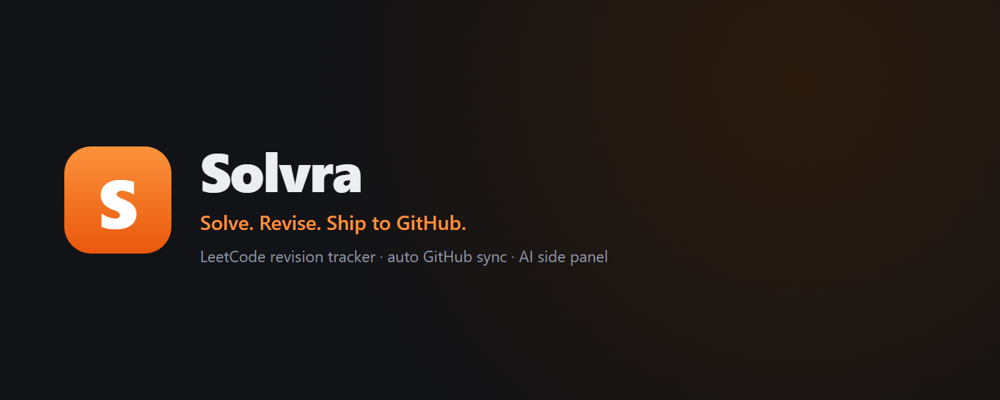
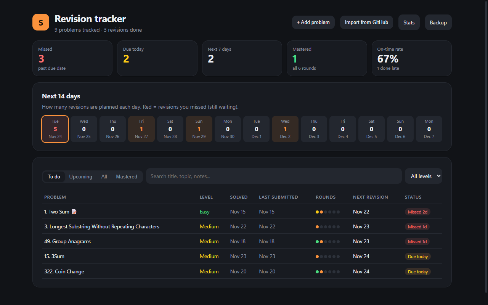
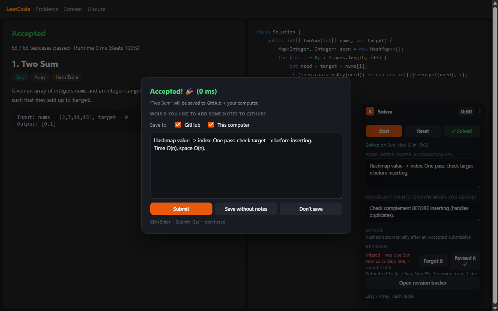
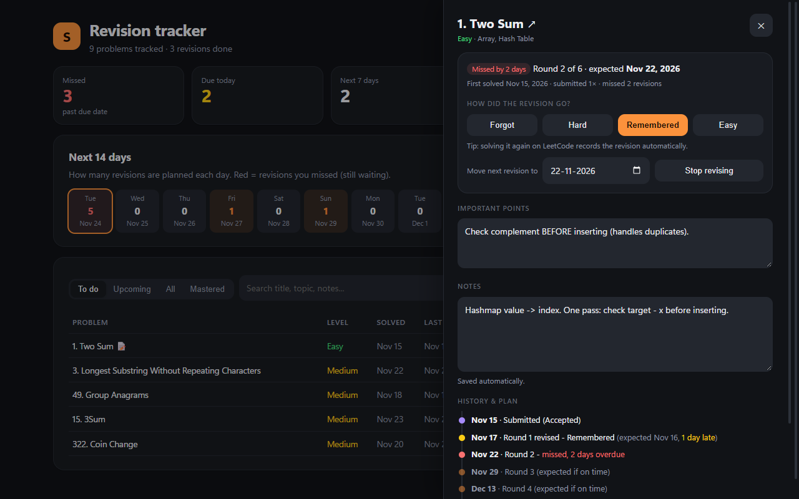
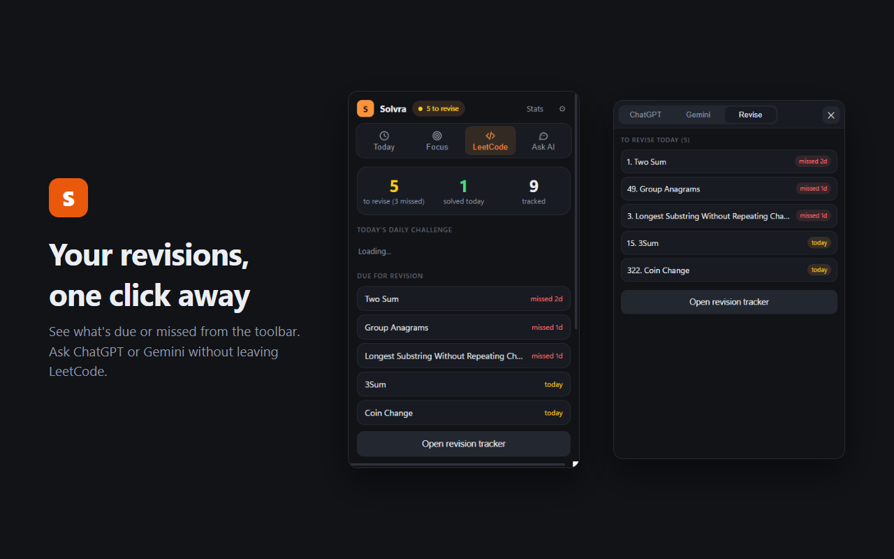

# Solvra

**Solve. Revise. Ship to GitHub.**

Solvra is a free browser extension for LeetCode practice. It schedules each solved problem for revision (spaced repetition), tells you what you missed, and saves every Accepted solution, with your notes, to GitHub and/or your computer.

## Features
- **Revision tracker.** Solved problems come back after 1, 3, 7, 14, 30 and 60 days. Solvra shows what's due today, what you **missed** (and by how many days), and the full history for each problem.
- **Notes & important points** for every problem, shown again when you revise.
- **Auto save on Accepted.** A pop-up asks if you want to add notes, then saves your code plus a README to **GitHub** (one-click login) and/or **a folder on your computer**.
- **Automatic LeetCode status.** Solved, Attempted or Not solved is read from your LeetCode account.
- **Reminders** when you open your laptop if revisions are due or missed.
- **AI Assistant:** ChatGPT and Gemini in a side panel (Alt+Shift+A).
- **Focus tools:** ad blocker, site blocker for study hours, Clean YouTube, time tracker.
- **Private:** no server, no tracking. Your data stays in your browser.

| | |
|---|---|
|  |  |
|  |  |

## Install (Chrome, Brave or Edge) - 1 minute
1. Download **`solvra-1.6.0.zip`** from the [latest release](../../releases/latest) and **unzip** it into a folder you'll keep (for example `Documents\Solvra`).
2. Open the extensions page:
   - Chrome: `chrome://extensions`
   - Brave: `brave://extensions`
   - Edge: `edge://extensions`
3. Turn on **Developer mode** (top-right corner).
4. Click **Load unpacked** and select the unzipped folder (the one that contains `manifest.json`).
5. Pin Solvra: click the puzzle-piece icon, then the pin next to **Solvra**.
6. The Welcome page opens. Click **Login with GitHub**, press **Authorize**, and pick your repo. Done.

> Don't delete or move the folder afterwards. The browser loads Solvra from it.

## Update to a new version
1. Back up first: Solvra Settings, then Your data, then **Back up now**.
2. Download the new zip and unzip it **over the same folder** (replace the files).
3. Press reload ⟳ on Solvra in the extensions page. Your data stays.

## Privacy
See [PRIVACY.md](PRIVACY.md). In short: no server and no tracking. Only your solutions and notes go to your own GitHub repo.

## Credits
- Created by [Vishwajeet](https://github.com/Vishwajeet0101).
- Built with the help of **[Claude](https://claude.ai)** by Anthropic (Claude Code), co-author of the code and design.

Not affiliated with LeetCode, GitHub, OpenAI or Google.
